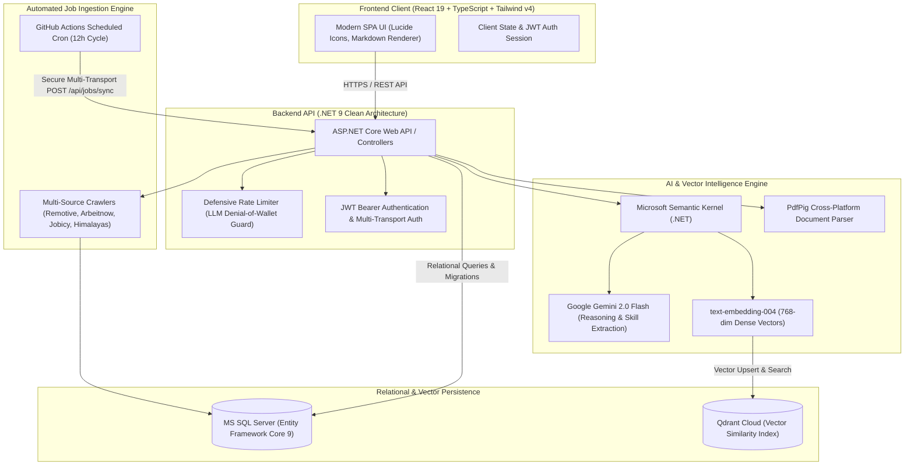

# S7JobSeeker
> **AI-Powered Semantic & RAG Job Matching SaaS Platform, 180+ BD Tech Companies Ecosystem & Core Banking Career Intelligence**

[](https://s7jobseeker.runasp.net)
[](https://dotnet.microsoft.com/)
[](https://dotnet.microsoft.com/apps/aspnet)
[](https://react.dev/)
[](https://www.typescriptlang.org/)
[](https://tailwindcss.com/)
[](https://github.com/microsoft/semantic-kernel)
[](https://qdrant.tech/)
[](https://ai.google.dev/)
[]()
[](LICENSE)

---

## Live Production Application
- **Production URL**: [https://s7jobseeker.runasp.net](https://s7jobseeker.runasp.net)
- **API Swagger Documentation**: [https://s7jobseeker.runasp.net/swagger](https://s7jobseeker.runasp.net/swagger)
- **Status Endpoint**: [https://s7jobseeker.runasp.net/api/health](https://s7jobseeker.runasp.net/api/health)

---

## Executive Overview
`S7JobSeeker` হলো একটি এন্টারপ্রাইজ-গ্রেড AI-চালিত SaaS প্ল্যাটফর্ম, যা সফটওয়্যার ইঞ্জিনিয়ার ও টেক প্রফেশনালদের ক্যারিয়ার গ্রোথ, জব ম্যাচিং এবং টেকনিক্যাল প্রিপারেশনের সম্পূর্ণ যাত্রা সহজ করার জন্য নির্মিত। 

সিস্টেমটি প্রার্থীর রেজুমি পার্স করে ৭৬৮-ডাইমেনশনাল ভেক্টর এমবেডিং তৈরি করে, Qdrant ভেক্টর ক্লাউডের মাধ্যমে রিয়েল-টাইম জবের সাথে সিম্যান্টিক সিমিলারিটি স্কোরিং করে, স্কিল গ্যাপ চিহ্নিত করে এবং জব সার্কুলার অনুযায়ী কাস্টমাইজড কভার লেটার প্রস্তুত করে। 

পাশাপাশি প্ল্যাটফর্মটিতে যুক্ত রয়েছে **১৮০+ বাংলাদেশি গ্লোবাল টেক কোম্পানি ডিরেক্টরি** (যাতে .NET ও C# নিয়ে কাজ করা ৩০+ এন্টারপ্রাইজ কোম্পানির বিশেষায়িত ক্লাস্টার অন্তর্ভুক্ত) এবং **১৪-দিনের teamS7 সিবিএস ইঞ্জিনিয়ারিং ইমার্শন মডিউল** সহ ভেরিফায়েড ডিজিটাল ক্রেডেনশিয়াল জেনারেটর।

---

## System Architecture



---

## Flagship Features

### ১. Semantic RAG Job Matching & Custom Circular Analyzer
- **Automatic Resume Parsing**: `PdfPig`-এর মাধ্যমে কোনো বাহ্যিক থার্ড-পার্টি সার্ভিস ছাড়া লোকালি ও নিরাপদে প্রার্থীর রেজুমি (PDF) থেকে টেক্সট, স্কিল ও কাজের অভিজ্ঞতা এক্সট্রাক্ট করা হয়।
- **Vector Search (Qdrant)**: গুগলের `text-embedding-004` মডেল দিয়ে প্রার্থীর প্রোফাইলের ৭৬৮-ডাইমেনশনাল ভেক্টর তৈরি করে Qdrant ক্লাউডে কসিন সিমিলারিটি সার্চ চালানো হয়।
- **Hybrid Match Scoring Algorithm**: শুধু কি-ওয়ার্ড ম্যাচিং নয়, প্রার্থীর টার্গেট রোল, অভিজ্ঞতার কার্ভ (Experience Curve) এবং টেক স্ট্যাক সামঞ্জস্যের ওপর ভিত্তি করে ০-১০০% ম্যাচ স্কোর প্রদান করা হয়।
- **Paste & Analyze Any Circular**: যেকোনো পোর্টাল (BDJobs, LinkedIn, Company Careers) থেকে সরাসরি সার্কুলার টেক্সট পেস্ট করে তাৎক্ষণিক ম্যাচ স্কোর, স্কিল গ্যাপ এবং কাস্টমাইজড কভার লেটার জেনারেট করা যায়।

### ২. 180+ BD Global Tech Companies Ecosystem (.NET Enterprise Specialization)
- **Curated Ecosystem**: বাংলাদেশের ১৮০+ স্বনামধন্য সফটওয়্যার ও টেক কোম্পানিকে ৬টি মূল ক্লাস্টারে বিন্যস্ত করা হয়েছে:
  - *Global SaaS & Product Companies*
  - *Enterprise Software & Outsourcing*
  - *Fintech & Digital Banking*
  - *Cloud, DevOps & Managed Services*
  - *AI, Data Engineering & Cyber Security*
  - *Creative Agency & Custom Development*
- **Dedicated .NET & C# Enterprise Cluster**: মাইক্রোসফট টেকনোলজি স্ট্যাক (.NET Core, ASP.NET, C#, Azure, SQL Server) নিয়ে কাজ করা ৩০+ শীর্ষস্থানীয় এন্টারপ্রাইজ কোম্পানি (যেমন: Therap, Brain Station 23, Enosis Solutions, BJIT, Cefalo, Kona Software Lab, Kaz Software, Dynamic Solution Innovators, BJIT, ইত্যাদি) আলাদা ফিল্টারে সাজানো।
- **Community Contribution**: বাদ পড়া কোনো কোম্পানি থাকলে প্রার্থীরা প্ল্যাটফর্ম থেকেই "Suggest a Company" ফর্মের মাধ্যমে যুক্ত করার অনুরোধ জানাতে পারেন।

### ৩. 14-Day teamS7 CBS Engineering Immersion Hub
- **Modular Curriculum**: ব্যাংকিং টেকনোলজি ও কোর ব্যাংকিং সিস্টেম (CBS) ক্যারিয়ার প্রস্তুতির জন্য ১৪ দিনের মডুলার কারিকুলাম।
- **5-Tab Integrated Hub**: Overview, Curriculum Modules, Diagnostic Labs, Timed Mock Assessment, এবং Digital Certificate।
- **Live Production Diagnostics**: ডার্ক টার্মিনাল এসকিউএল স্ক্রিপ্ট, লিনাক্স ট্রাবলশুটিং কমান্ড, ডকার অপারেশনস এবং EOD (End-of-Day) ব্যাচ ফেইলিউর ডায়াগনস্টিকস।
- **Verified Digital Certificate**: মক অ্যাসেসমেন্টে ৭০%+ মার্কস অর্জন করলে প্রার্থীর নাম, অর্জিত স্কোর এবং ডিজিটাল ভেরিফিকেশন আইডি সহ ডাউনলোডযোগ্য প্রফেশনাল সার্টিফিকেট জেনারেট হয়।

### ৪. 4-Stage AI Interview & Assessment Master Blueprint
- **Stage 1 (Domain Fundamentals)**: ব্যাংকিং আর্কিটেকচার, ট্রানজেকশনাল কনকারেন্সি, ACID প্রোপার্টিজ এবং গ্যাপ অ্যানালাইসিস।
- **Stage 2 (Diagnostic Labs)**: ওয়ান-ক্লিক কপি সুবিধাসহ রিয়েল-ওয়ার্ল্ড এসকিউএল কোয়েরি ও ইনসিডেন্ট হ্যান্ডলিং স্ক্রিপ্ট।
- **Stage 3 (Mock Assessment & P1 Mistakes)**: সিনিয়র ইঞ্জিনিয়ার মডেল উত্তর এবং ক্রিটিক্যাল প্রোডাকশন মিসটেক পরিহার গাইড।
- **Stage 4 (Readiness Dossier)**: অফলাইন স্টাডির জন্য সম্পূর্ণ গাইডটি এক ক্লিকে ফরম্যাটেড `.md` ডসিয়ার হিসেবে ডাউনলোড সুবিধা।

### ৫. SaaS Monetization & Director Admin Console
- **Credit Engine**: সাইন-আপের সাথে ৩০ দিনের ফ্রি ট্রায়াল ও ২০টি এআই ক্রেডিট।
- **Bangladeshi Payment Gateways**: বিকাশ (bKash), নগদ (Nagad), এবং রকেট (Rocket) ম্যানুয়াল ট্রানজ্যাকশন আইডি ও স্ক্রিনশট ভেরিফিকেশন।
- **Director Console**: অ্যাডমিন ডিরেক্টর (`formal.teams7@gmail.com`) যেকোনো ইউজারের ক্রেডিট ব্যালেন্স সরাসরি টপ-আপ, সাবস্ক্রিপশন মেয়াদ বৃদ্ধি ও ভেরিফাই করতে পারেন।

### ৬. Resilient Multi-Transport Automated Job Sync
- **Automated Crawlers**: Remotive, Arbeitnow, Jobicy, এবং Himalayas এপিআই থেকে প্রতি ১২ ঘণ্টায় স্বয়ংক্রিয়ভাবে গ্লোবাল ও রিমোট জব ইনজেশন।
- **Hardened Defense-in-Depth Auth**: ক্লাউড প্রক্সি, WAF বা IIS ARR কাস্টম হেডার ড্রপ করলেও রিকোয়েস্ট যেন ব্যর্থ না হয়, সেজন্য ৩টি চ্যানেলে ব্যাকএন্ড অথেনটিকেশন সাপোর্ট:
  1. RFC Standard: `Authorization: Bearer <cron_key>`
  2. Legacy Header: `X-Cron-Key: <cron_key>`
  3. Fail-safe Query: `POST /api/jobs/sync?cronKey=<cron_key>`

---

## Technology Stack

| Layer | Technology | Purpose |
| :--- | :--- | :--- |
| **Backend Framework** | **.NET 9 / ASP.NET Core** | High-performance Web API, Dependency Injection, Middleware |
| **AI Orchestration** | **Microsoft Semantic Kernel** | LLM orchestration, structured output parsing, prompt planning |
| **Generative LLM** | **Google Gemini 2.0 Flash** | Resume analysis, mock assessment grading, circular gap analysis |
| **Vector Embeddings** | **text-embedding-004** | 768-dimensional dense vector embeddings |
| **Vector Database** | **Qdrant Cloud** | Cosine similarity HNSW indexing for instant semantic job matching |
| **Relational Database**| **MS SQL Server** | Enterprise persistence via **Entity Framework Core 9** |
| **Document Parsing** | **PdfPig** | Cross-platform, managed C# PDF text and metadata extraction |
| **Frontend SPA** | **React 19 (TypeScript)** | Next-generation React with Hooks, typed DTOs and fast VDOM |
| **Styling & Icons** | **Tailwind CSS v4 + Lucide** | Modern design system, responsive mobile-first UI, Lucide icons |
| **Markdown Engine** | **react-markdown + remark-gfm**| Production-grade technical documentation, lab syntax highlighting, tables |
| **CI/CD & Hosting** | **GitHub Actions + FTPS** | Automated release deployment to **MonsterASP.net** & scheduled cron |

---

## Clean Architecture & Anti-Regression Standards

প্রজেক্টটি মনোলিথিক ওভার-ইঞ্জিনিয়ারিং পরিহার করে ক্লিন আর্কিটেকচার এবং **Anti-Regression In-Code Decision Locks** কঠোরভাবে অনুসরণ করে:

```text
S7JobSeeker/
├── src/
│   ├── Backend/
│   │   ├── S7JobSeeker.Core/             # Entities, Domain Enums, Interfaces, DTOs
│   │   ├── S7JobSeeker.Infrastructure/   # EF Core DbContext, Migrations, Job Fetchers, Qdrant Client
│   │   ├── S7JobSeeker.AI/               # Semantic Kernel Services, JobMatcher, CbsSprint, Parsers
│   │   └── S7JobSeeker.Api/              # Controllers, Rate Limiting, JWT Auth, Program.cs
│   └── Frontend/                         # React 19 SPA, Tailwind CSS v4, Components, Services
└── tests/
    └── S7JobSeeker.Tests/                # 53 Automated Unit, Integration & Security Tests
```

### In-Code Decision Lock উদাহরণ:
```csharp
// ARCHITECTURAL INTENT: Relational-first persistence. Add and save all new jobs to MSSQL
// immediately before vector indexing so that network latency or Gemini 15 RPM
// rate limits never starve the relational database or cause HTTP sync timeouts.
_dbContext.JobPostings.AddRange(newJobs);
await _dbContext.SaveChangesAsync(cancellationToken);
```
প্রতিটি আর্কিটেকচারাল সিদ্ধান্তের সাথে ইউনিট টেস্ট লক যুক্ত রয়েছে যাতে ফিউচার রিফ্যাক্টরিংয়ে কোনো রিগ্রেশন তৈরি না হয়।

---

## Quickstart Guide (Local Development)

### পূর্বশর্ত (Prerequisites)
- [.NET 9.0 SDK](https://dotnet.microsoft.com/download/dotnet/9.0)
- [Node.js 20+ & npm](https://nodejs.org/)
- SQL Server (বা LocalDB: `(localdb)\mssqllocaldb`)
- Google Gemini API Key (ফ্রি টিয়ার সাপোর্ট)

### ১. রিপোজিটোরি ক্লোন করুন
```bash
git clone https://github.com/real-sagirahmed/S7JobSeeker.git
cd S7JobSeeker
```

### ২. ব্যাকএন্ড কনফিগারেশন (`appsettings.json`)
`src/Backend/S7JobSeeker.Api/appsettings.json` ফাইলে আপনার কী-গুলো দিন:
```json
{
  "ConnectionStrings": {
    "DefaultConnection": "Server=(localdb)\\mssqllocaldb;Database=S7JobSeekerDb;Trusted_Connection=True;TrustServerCertificate=True;"
  },
  "GeminiSettings": {
    "ApiKey": "YOUR_GEMINI_API_KEY",
    "ModelId": "gemini-2.0-flash",
    "EmbeddingModelId": "text-embedding-004"
  },
  "QdrantSettings": {
    "Endpoint": "https://xyz-your-cluster.qdrant.tech:6333",
    "ApiKey": "YOUR_QDRANT_API_KEY",
    "CollectionName": "tech-jobs"
  },
  "CronSettings": {
    "SecretKey": "s7-cron-secret-key-change-in-production-2026"
  }
}
```

### ৩. ব্যাকএন্ড রান করুন
```powershell
cd src\Backend\S7JobSeeker.Api
dotnet run
```
- API ড্যাশবোর্ড ও Swagger UI: `http://localhost:5000/swagger`

### ৪. ফ্রন্টএন্ড রান করুন
```powershell
cd src\Frontend
npm install
npm run dev
```
- ফ্রন্টএন্ড অ্যাপ্লিকেশন: `http://localhost:5173`

### ৫. অটোমেটেড টেস্ট রান করুন
```powershell
dotnet test S7JobSeeker.sln --configuration Release
```
- **ফলাফল**: `Passed! - Failed: 0, Passed: 135, Skipped: 0, Total: 135`

---

## Production Deployment & CI/CD Pipeline

প্ল্যাটফর্মটি **GitHub Actions**-এর মাধ্যমে সম্পূর্ণ স্বয়ংক্রিয়ভাবে বিল্ড, টেস্ট ও ডিপ্লয় হয়:
1. `main` ব্রাঞ্চে কোনো কমিট পুশ হলে `.github/workflows/deploy.yml` ট্রিগার হয়।
2. React ফ্রন্টএন্ড টাইপস্ক্রিপ্ট সহ প্রডাকশন বিল্ড হয় এবং ব্যাকএন্ডের `wwwroot/`-এ মার্জ হয়।
3. .NET 9 এপিআই রিলিজ কনফিগারেশনে পাবলিশ হয়।
4. মোট ১৩৫টি অটোমেটেড ইউনিট ও ইন্টিগ্রেশন টেস্ট রান করে। টেস্ট পাস করলেই কেবল ডিপ্লয়মেন্ট অগ্রসর হয়।
5. MonsterASP.net হোস্টিংয়ে FTPS-এর মাধ্যমে লাইভ সার্ভার আপডেট সম্পন্ন হয়।

---

## Author & Professional Profile

**Sagir Ahmed**  
*Senior Full Stack .NET Developer, Solutions Architect & AI Systems Engineer*  

- **Personal Portfolio**: [https://sagirahmed.com](https://sagirahmed.com)
- **LinkedIn Profile**: [linkedin.com/in/real-sagirahmed](https://www.linkedin.com/in/real-sagirahmed)
- **GitHub Profile**: [@real-sagirahmed](https://github.com/real-sagirahmed)
- **Professional Email**: [real.sagirahmed@gmail.com](mailto:real.sagirahmed@gmail.com)

---

## License
This project is open-source and licensed under the [MIT License](LICENSE).
Feel free to star the repository and fork for personal use or learning.
